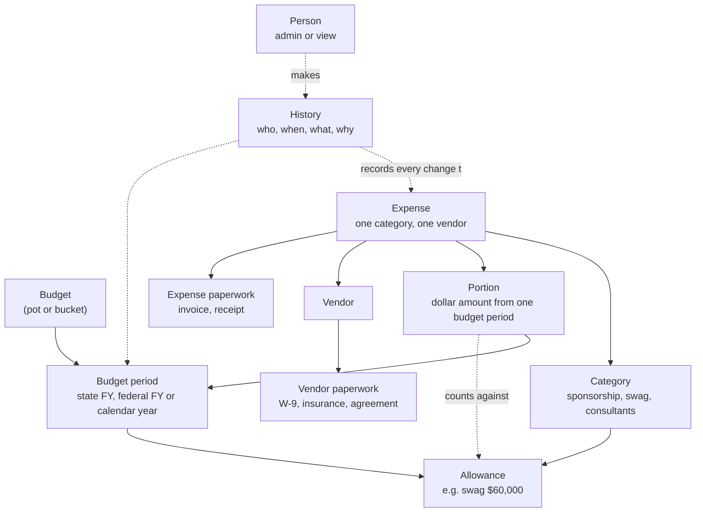

# Money Model

First draft, 2026-11-13. A thinking document, written to be argued with before
anything is built. Nothing here is decided until Kelly has read sections 2 and 3
and said yes, no, or not quite, line by line.

## How to read this

Every statement that comes from a call carries a source in square brackets:
the call, the speaker, and the timestamp. Everything else is marked
**Assumption**. Where the calls point two ways, both ways are shown and nothing
is picked.

| Short name | Call |
| --- | --- |
| Intro | 2026-10-08, first call, Kelly and Dylan |
| Prep | 2026-10-14, Dylan's solo notes before discovery |
| Discovery | 2026-10-14, in-person session, Kelly and Dylan |
| Questions | 2026-11-13, Kelly's pre-approval questions |
| Proposal | M+P proposal, October 2026. What we told Kelly, not what she told us |

All money is stored as whole cents. That is the last time this document
mentions it.

---

## 1. The things in the system

### In plain English

**Budget.** Kelly also calls it a pot or a bucket of money [Intro, Kelly, 02:38].
Where the money comes from and the rules that come with it. Today there are four:
Louisiana Innovation Marketing ($1.3M), Louisiana Growth Network and Small
Business Services ($500K), Rural Tech Catalyst Fund admin ($600K), and SSBCI
program income (about $2.6M, moves with interest rates) [Discovery, Kelly, 11:50].
More will come, for example innovation funds after the next legislative session
[Questions, Kelly, 03:57]. Kelly adds and retires budgets herself
[Questions, Dylan, 04:04].

**Budget period.** One run of a budget: a state fiscal year, a federal fiscal
year, or a calendar year [Questions, Kelly, 02:52]. A budget has a starting amount
for each period. Each budget says whether unspent money rolls over into its next
period [Questions, Kelly, 02:52; Dylan, 03:48].

**Category.** What kind of spending it is: sponsorships, subscriptions,
consultants, paid media, swag, memberships, professional services
[Discovery, Kelly, 13:39; Questions, Kelly, 17:18]. The same set mostly applies
across all budgets [Discovery, Kelly, 13:39], with the odd one that only applies
to some, like an IT line for innovation [Discovery, Dylan and Kelly, 14:14].
Kelly is sending the full list [Questions, Kelly, 17:18].

**Allowance.** An amount set aside inside a budget for one category, like $60,000
for promotional swag [Discovery, Kelly, 02:39]. What gets spent against it should
come off it on its own. Today it does not, and that is one of the core
complaints [Discovery, Kelly, 02:39 and 08:43].

**Earmark or event.** Kelly also sets money aside for a named thing, like a
Spotlight or an Innovation Day, with smaller expenses underneath it
[Discovery, Kelly, 08:43]. **Open:** this may be the same thing as an allowance,
or a separate grouping that sits across categories. See section 6.

**Expense.** Kelly calls these expense items or budget items, and calls the
unpaid ones the pipeline [Discovery, Kelly, 02:39 and 08:14]. One thing being
bought, from one vendor, in one category, paid from one or more budgets.

**Portion.** **Assumption, our word.** The part of one expense paid from one
budget. An expense paid from a single budget has one portion. The build itself is
the live example: one contract, three portions, from LA.IO marketing, Rural Tech
Catalyst Fund admin and SSBCI program income [Questions, Kelly, 16:03].

**Vendor.** Kelly says vendor or contractor [Discovery, Kelly, 18:47]. Who gets
paid. To be paid by the state a vendor has to be set up, and LED has to hold their
W-9 at least once [Questions, Kelly, 10:55].

**Paperwork.** The invoice, W-9, sponsorship agreement, receipt
[Intro, Kelly, 05:12]. Some belongs to the vendor (the W-9). Some belongs to the
expense (the invoice). A number should always lead to the paper behind it
[Discovery, Kelly, 40:29].

**Person.** Someone who signs in. Kelly is admin and sets everyone else's level
[Questions, Dylan, 05:24]. Katie, Josh and Chris can view [Questions, Kelly, 05:12].
Josh also adds planned spending ahead of a new fiscal year
[Discovery, Kelly, 02:01], so view may not be enough for him. See section 6.

**History.** Every change to anything above, kept: who, when, what, and why.
Kelly already works this way by hand. She zeroes out a cancelled item and leaves a
comment rather than deleting it, because Monday.com deletes for good
[Discovery, Kelly, 18:47].

### How they connect

Read it as: an expense belongs to one category and one vendor, and is paid
through one or more portions. Each portion takes a dollar amount from one budget
period, and counts against that period's allowance for the expense's category if
there is one.

---

## 2. The money rules

Kelly: each line is meant to be checked. Yes, no, or not quite.

### Budgets

1. Each budget has its own year: state fiscal year (ends 30 June), federal fiscal
   year (ends 30 September), or calendar year. [Questions, Kelly, 02:52]
2. Each budget has its own rule for leftover money: it carries into the next
   year, or it is gone. [Questions, Kelly, 02:52; Dylan, 03:48]
3. Kelly can add a new budget and set its rules, and can retire a budget that
   goes away. [Questions, Dylan, 04:04]
4. Kelly can change a budget's rules later if they turn out wrong.
   [Questions, Dylan, 03:48 and 05:01]
5. The starting amount for a year is one number, handed down from Susan to Josh.
   Josh and the team then split it into categories at the start of the year, and
   leave some unassigned for miscellaneous spending. [Discovery, Kelly, 30:39 and 30:44]
6. The SSBCI program income amount changes with interest rates. Kelly enters the
   new figure when fiscal gives it to her, and the system shows the date it was
   last updated. [Discovery, Kelly, 11:50; Dylan, 13:20; Proposal]
7. A budget's amount can go down as well as up during the year, and the system
   shows every change rather than replacing the number. **Assumption.** The calls
   show this happens to SSBCI [Discovery, Kelly, 13:01] and could happen to Rural
   Tech if the wider $20M is not committed in time [Discovery, Kelly, 15:05].

### Categories and allowances

8. Every expense has exactly one category, even when it is paid from several
   budgets. [Questions, Dylan and Kelly, 17:50]
9. When Kelly records an expense she picks a category, or adds a new one on the
   spot. [Questions, Dylan, 13:02]
10. A category can have an allowance inside a budget, like $60,000 for swag.
    [Discovery, Kelly, 02:39]
11. Every expense in that category comes off that allowance on its own, and the
    allowance shows what is left. [Discovery, Kelly, 02:39; Dylan, 04:04]
12. A category with no allowance still adds up everything spent in it.
    **Assumption.**
13. The same category name means the same thing in every budget, so "how much on
    sponsorships this year" can be answered across all of them.
    [Questions, Kelly, 12:28; Discovery, Dylan, 14:14]

### Expenses and splits

14. An expense can be paid from more than one budget, with a dollar amount
    against each. [Discovery, Kelly, 16:47; Questions, Kelly, 16:03]
15. The amounts against each budget always add up to the full expense.
    **Assumption.**
16. Whether a split can also be set as a percentage is not decided. See section 6.
17. Every expense has a vendor. **Assumption.** Some small purchases may not need
    one. See section 6.
18. An expense can be linked to a contract or agreement number, so all the
    pieces of one contract can be found together. [Questions, Kelly, 16:03]
19. Nothing is ever deleted. A cancelled expense stays in the record, marked
    cancelled, with the reason. [Discovery, Kelly, 18:47; Proposal]
20. Every change records who made it, when, and why. [Discovery, Kelly, 18:47;
    CLAUDE.md]

### What is left

21. What is left in a budget = the starting amount, minus what is paid, minus
    what is planned but not yet paid. **Assumption** on whether planned spending
    counts against what is left. Kelly deducts planned items from the running
    balance today so she does not double count [Discovery, Kelly, 08:43], which
    suggests yes.
22. The system always shows these separately: started with, planned, paid, left.
    [Proposal, from Intro, Dylan, 02:16]
23. When an expense comes in under what was planned, the difference goes back to
    what is left on its own. [Discovery, Dylan and Kelly, 09:14 and 09:25]
24. The system never stops Kelly from going over a budget or an allowance.
    **Assumption.** It warns her and shows it clearly. Overspending is a people
    problem, and the fix is that the number is always visible
    [Discovery, Kelly, 24:05 and 24:26]. Whether it should block instead is open.
25. Each budget with a deadline shows whether spending is on pace to use the
    money in time. [Proposal, from Discovery, Kelly, 14:48]

---

## 3. The life of an expense

**Assumption** on the names of the stages. Kelly's words are pipeline and paid
[Discovery, Kelly, 08:14]. The proposal used promised. The steps in between come
from how she described a sponsorship moving through ProcureTrack and fiscal
[Discovery, Kelly, 18:47; 17:11]. Kelly, please correct the stages themselves
before the details under them.

### Stage 1. Planned

Someone knows the spending is coming. Josh earmarks money for things ahead of a
new year [Discovery, Kelly, 02:01]. Someone asks Kelly whether there is room for
a sponsorship [Discovery, Kelly, 18:47].

+ Has: a description, a rough amount, a category, which budget or budgets.
+ Vendor may not be known yet.
+ Counts against what is left, so the money is not promised twice.
+ Can change: anything. Amount, category, budget, vendor.
+ Can be cancelled. It stays in the record, marked cancelled, with the reason.

### Stage 2. Requested

**Assumption** that this is a separate stage. The formal request is in
ProcureTrack, Kelly has coded it to a budget, and it is going through approval:
Kelly, then Josh, then fiscal [Intro, Kelly, 05:12; Discovery, Kelly, 05:38].

+ Has: the exact vendor and the exact amount, updated from the rough number
  [Discovery, Kelly, 18:47].
+ Can change: amount, category, budget split. Each change is recorded with a reason.
+ Can be cancelled, same as above.

### Stage 3. With fiscal

**Assumption** that this is a separate stage. Approved and sent to fiscal for
payment, not yet paid.

+ Can still be moved to a different budget, but Kelly also has to change it in
  ProcureTrack and may have to call fiscal [Discovery, Kelly, 21:46]. The system
  should remind her of that.
+ Amount can still change if the invoice differs.

### Stage 4. Paid

The money has left. Kelly records the date and the final amount
[Discovery, Kelly, 02:39].

+ Moving one click from the stage before, with no retyping.
  [Proposal, from Discovery, Kelly, 08:14]
+ Can change budget or category only rarely, and only while fiscal has not sent
  the money out the door. [Discovery, Kelly, 17:11] **Open:** once fiscal has
  paid, can it still be recoded in this system to match a later fix in fiscal's
  books? See section 6.
+ An amount correction is a new entry with a reason, never a changed number.
+ Cannot be cancelled. A refund or a reversal would be its own entry.
  **Assumption.**

### After the year closes

An expense paid in a year that is closed stays as it was. Kelly said recoding a
paid item from a past fiscal year is close to moot, because it would already have
been reported [Discovery, Kelly, 18:15]. A correction is still possible, marked
as made after the close (see section 5).

### At any stage

+ Paperwork can be attached at any point.
+ A note can be added at any point, by Kelly or through Claude.
+ Claude can change the category, add a note, or reclassify. Claude cannot change
  an amount, move money between budgets, or create an expense
  [CLAUDE.md]. Moving an expense to a different budget counts as moving money, so
  that stays a screen action for Kelly. **Assumption**, worth confirming, because
  it is the change Kelly said happens when Josh changes his mind
  [Discovery, Kelly, 17:11].

---

## 4. How a budget year works

### Opening

A new year opens with its starting amount and its allowances. Kelly and Josh set
the split at their start-of-year meeting [Discovery, Kelly, 30:44]. Josh plans
next year's spending before the year opens [Discovery, Kelly, 02:01], so a year
can be prepared before its start date. **Assumption.**

### Running

Every expense portion belongs to one year of one budget. Balances, allowances and
pace all calculate from the record. The biweekly budget meeting is when Kelly,
Josh and Katie check them [Discovery, Kelly, 26:39].

### Closing

Today, at year end, Kelly copies the planned-but-unpaid items onto a new
Monday.com board and deletes the old one [Discovery, Kelly, 22:47]. The system
replaces that with a walk-through: here is what is unspent, here is what is still
planned or unpaid, decide each one, then the year is archived
[Discovery, Dylan, 23:11; Proposal]. The closed year stays viewable, and exports
to a spreadsheet and a readable report [Questions, Dylan, 07:08].

Kelly also wants the close to show what was spent in each category, so the team
can ask whether a sponsorship was worth doing again [Discovery, Kelly, 23:26].

### The three year types

| | State fiscal year | Federal fiscal year | Calendar year |
| --- | --- | --- | --- |
| Ends | 30 June | 30 September | 31 December |
| Known budgets | LA Innovation Marketing, Growth Network and Small Business Services [Discovery, Kelly, 16:13; Dylan and Kelly, 16:36] | Rural Tech Catalyst Fund admin [Discovery, Kelly, 15:05] | None named yet. Kelly said some budgets are calendar year [Questions, Kelly, 02:52] |
| Leftover money | Gone. A new amount arrives, unrelated to what was left [Discovery, Kelly, 14:48 and 16:13] | Gone. New $600K each year of a five-year program [Discovery, Kelly, 15:05] | Unknown |

SSBCI program income has no deadline. LED keeps it even after the program ends
on 31 December 2027 [Discovery, Kelly, 15:05]. Kelly said one pot rolls over
without naming it [Questions, Kelly, 02:52]. SSBCI is the likely one, but that is
our inference from Discovery, not something she said. Which year type it reports
on is unknown.

The proposal says Rural Tech is "at risk by June." The calls say its deadline is
the federal year end, 30 September. One of them is wrong. See section 6.

### Unspent money at close

+ **Rollover off:** the unspent amount is recorded as lapsed. It does not move
  anywhere. The new year starts with its own amount.
+ **Rollover on:** the unspent amount is carried into the next year as a visible
  line, so the new year shows "started with X, carried in Y."
  **Assumption** that it is shown separately rather than blended in.

### Unpaid expenses at close

This is the hardest question in the document, and only Kelly can answer it.
Three options. Nothing is picked.

**Option A. It moves to the new year's money.** What Kelly does today by copying
items onto the new board [Discovery, Kelly, 22:47]. Implies: next year's
starting balance is already partly spent on day one, and the old year closes
with that money counted as lapsed.

**Option B. It stays on the old year's money and is paid from it after the
close.** How many governments treat money committed before year end.
Implies: a closed year can still receive payments for a while, and the old year
cannot be fully final until they land.

**Option C. Kelly decides each one at close.** Move it, keep it, or cancel it.
Implies: the most flexible and the most work at the busiest moment of the year.

A split expense makes this harder. If one expense is paid from a state budget
(closes 30 June) and a federal one (closes 30 September), each portion follows
its own budget's close. **Assumption.**

---

## 5. Nothing is overwritten

### What gets stored

The system does not store "the swag allowance is $41,500." It stores everything
that happened, in order:

+ 1 July. Kelly set the swag allowance in LA Innovation Marketing to $60,000.
+ 3 August. Kelly planned branded socks, $12,000, swag, LA Innovation Marketing.
+ 9 September. Kelly updated the socks to $11,500 from the invoice.
+ 2 October. Kelly marked the socks paid, $11,500.

What is left, $48,500, is worked out from that list every time someone looks.
There is no second copy of the number that could drift.

### What a correction looks like

Kelly typed $11,500. The invoice says $11,050. She does not edit the old number.
She records a correction:

+ 14 October. Kelly corrected the socks from $11,500 to $11,050. Reason: invoice
  amount was mistyped.

Every total now reflects $11,050. The $11,500 is still visible in the item's
history, with when it was wrong and who fixed it.

Moving an expense to another budget works the same way. "15 October. Kelly moved
the Innovation Day expense from LA.IO marketing to SSBCI program income. Reason:
Josh asked." The earlier version, and every total it fed, stays in the record.

Cancelling is a correction too. It replaces what Kelly does by hand today,
zeroing a number and leaving a comment [Discovery, Kelly, 18:47].

### What falls out of this

+ **The audit trail is the record itself.** There is nothing extra to keep in
  step. Who did what, when and why is the list above.
+ **Any date can be looked at as it was.** What did SSBCI look like on 1 March?
  Read the entries up to 1 March.
+ **Exports are repeatable.** A public records request about FY27 gets the same
  answer whenever it is run. If something was corrected after the close, the
  export says so and shows both, because the record shows both
  [Questions, Kelly, 07:32].
+ **Claude is held to the same rules.** A change made through Claude is an entry
  like any other, marked as made by Kelly through Claude, with what she asked.
  It can be read, questioned and reversed like a screen change.
+ **Rule changes are recorded too.** Turning rollover on, adding a budget,
  retiring a category. A report from last year explains itself with last year's
  rules.

### What can still be fixed silently

Nothing that is money. A typo in a vendor's street address or a note is still
recorded as a change, but does not need a reason. **Assumption** on where that
line sits.

---

## 6. Where we are guessing

Each of these is also in OPEN-QUESTIONS.md.

1. **The stages of an expense.** Kelly has only named pipeline and paid. The
   requested and with-fiscal stages are our reading of how ProcureTrack and
   fiscal work. Resolved by Kelly correcting section 3.
2. **Unpaid expenses at close.** Options A, B and C above. Resolved by Kelly,
   ideally with how fiscal actually handles a June expense paid in July.
3. **Does planned spending count against what is left?** Rule 21. Her habit
   says yes. Resolved by one sentence from Kelly.
4. **Allowances and earmarks.** The $60K swag allowance is a category inside a
   budget. Innovation Day may be a different thing: a named event with expenses
   from several categories under it [Discovery, Kelly, 08:43]. Kelly also used
   "subcategory" for both sponsorships under marketing [Discovery, 13:39] and
   socks under swag [Discovery, 02:39]. Options: one level (category with
   allowance), two levels (category, then a named group inside it), or a
   separate event or project tag that cuts across categories. Each implies a
   different screen. Resolved by her Monday.com export, which shows how she
   actually groups things.
5. **Split by dollars or by percentage.** The calls only show dollar amounts.
   A contract split three ways might be agreed as a percentage. Resolved by the
   CSA, which is the live example.
6. **Which budget is calendar year.** Kelly said some are. None of the four
   named budgets is. Resolved by Kelly.
7. **Rural Tech's deadline.** The calls say 30 September; the proposal says June.
   Resolved by Kelly, and the proposal language corrected if it is wrong.
8. **SSBCI's year.** It never lapses, but it has to report on some year.
   Resolved by Kelly.
9. **Recoding after payment.** Kelly said possible until the money leaves
   [Discovery, 17:11]. Whether the system should allow a recode after that, to
   match a fix fiscal makes later, is unknown.
10. **Who can enter spending.** Josh adds planned spending today
    [Discovery, Kelly, 02:01] but is listed as view only. Resolved by Kelly
    choosing whether there is a level between admin and view.
11. **Claude and moving money.** Reclassifying is allowed for Claude; moving
    money between budgets is not. Moving an expense to another budget is both.
    We have put it on the not-allowed side. Resolved by Dylan, then confirmed
    with Kelly.
12. **Everything above is description.** Not one real row of data has been seen.
    Kelly's Monday.com export and one fiscal spreadsheet will contradict parts of
    this document, and that is the point of getting them before the build.
